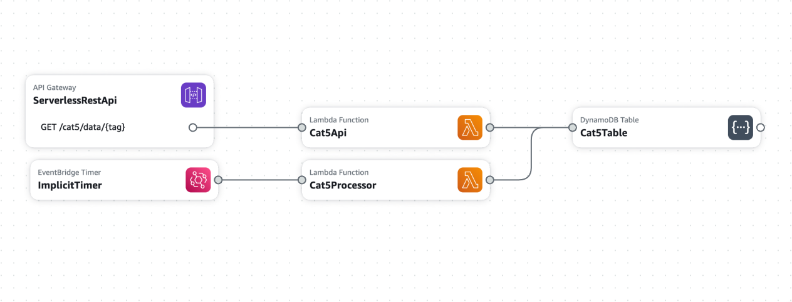

# CAT5
ESPN Fantasy Basketball H2H Categories Matchup Forecaster

Predict who will win each category

Predict who will win the matchup by winning the most categories. Categories and overall matchups can end in ties.

Forecasts include outright home-win probabilities (`win`, `catWin`) and tie
probabilities (`tie`, `catTie`). Away wins are `1 - home - tie`. Counting
categories model ties explicitly; uncertain FG% and FT% retain a continuous
approximation with zero estimated tie probability, while settled shooting
results can tie. Best lineups maximize the selected team’s outright win chance.

When deploying this change, deploy the processor and refresh stored forecasts
before publishing the UI. Older forecasts display “Tie unavailable” until refreshed.

https://cat5.jarno.site/

## Player projections

Per-game projections retain exponential recency weighting. Cumulative season,
30-day, 15-day, and 7-day stats are split into nonoverlapping groups, so each
observed game contributes once. Counting totals are preferred; per-game
averages multiplied by games played are used when totals are unavailable.
Individual game order is unavailable within each group, so production is
assumed constant inside that group.

Production and shot volume use a fixed 30-game smoothing span (`alpha = 2/31`).
A valid preseason per-game projection initializes the estimate. Its influence
fades by `(29/31)^games`, including beyond game 30, so there is no sudden cutoff
or slowdown in responsiveness later in the season. Without a preseason estimate,
smoothing starts from the oldest observed group; missing data does not insert
zero-production games. A player without observed data uses the preseason
projection, or zero if neither is available.

Shooting accuracy uses the same exponential-smoothing method in units of shot
attempts rather than games. Its span is 30 times the preseason per-game attempt
projection, with a minimum of 100 attempts. For example, 15 projected FGA gives
a 450-attempt span; two projected FTA gives a 100-attempt span. This preserves
roughly the existing 30-game scale for typical volume while requiring more
evidence for low-volume shooters. Without a valid positive preseason attempt
projection, the span is 100 and the first observed shooting group initializes
accuracy. Zero-attempt groups do not update accuracy. Within a group, attempts
are assumed to have a constant make probability because shot order is unknown.

Projected makes equal projected attempt volume times estimated shooting accuracy;
FG% and FT% remain projected makes divided by projected attempts. Zero projected
attempts produces a zero percentage. Shooting pairs must be complete and have
makes no greater than attempts.
Missing/null stats and invalid numeric inputs are unavailable data, while true
zeros remain observations. Contradictory narrower windows are skipped in favor
of the accepted broader window, allowing only small floating-point differences.

These spans are simple assumptions, not fitted parameters or a measured claim
of improved forecast accuracy. The method follows standard
[exponential smoothing](https://otexts.com/fpp3/exponential-smoothing.html).
The model still assumes independent Poisson counting totals,
a normal approximation for uncertain shooting percentages, and independent
category outcomes. Changing those assumptions or tuning the recency weights
requires backtesting.


## Lineup decisions

The optimizer considers every possible **number** of starts, including zero,
using ownership-ranked seeds, random subsets, and two passes of single-game
add/remove/swap improvements. The opponent remains at its default lineup.
This is an approximate search over the remaining weekly game cap, not a
complete daily lineup solver: position eligibility and daily slot limits
are not enforced. Exact ties favor fewer games used. Remaining capacity is
clamped to zero once the game cap is reached.

Player importance now measures a paired counterfactual in the same optimized
lineup. For each selected game, impact is the win chance lost when removing it
or using its best available replacement. For each benched game, impact is the
best win-chance change when adding it (if capacity allows) or swapping it for
a selected game. `PlayerValue.value` is the signed mean impact over that
player's eligible games, in probability units; the UI shows percentage points
per game. It replaces the old relative 0–1 score. Positive means valuable to
start, negative means valuable to bench, and impacts must not be added together.
They are matchup-specific and are not overall basketball talent ratings.

A player is labeled **Start** if all eligible games are selected and each has
more than 0.2 percentage points of impact; **Sit** if all are benched and each
costs more than 0.2 points to include. **Consider** includes mixed start counts,
close alternatives, and interchangeable dates. The threshold is a display
heuristic, not statistical confidence. Unavailable players and players without
remaining games stay visible. Player details include scheduled, eligible, and
recommended games, plus each eligible date's decision and impact.

`homeLineup` / `awayLineup` expose remaining capacity, available games,
recommended starts, unused slots, and `winByStarts`: the best probability found
at each start count. The UI distinguishes game shortages from deliberately
unused capacity and compares using no games, some games, or all available slots.
These comparisons are search estimates, not proven global optima.

### Injury returns

The pinned fantasy ESPN client exposes `injured` and `injuryStatus`; a checked
raw `mRoster` response also had no return dates. The separate public
[ESPN NBA injury feed](https://site.api.espn.com/apis/site/v2/sports/basketball/nba/injuries)
provides `details.returnDate` and `shortComment`. The handler fetches this feed
once with an eight-second timeout. It is optional: failure preserves the
roster-status fallback. Only the current NBA season, a matching feed season,
and a feed updated within 48 hours are accepted, so current injuries are never
injected into historical forecasts.

A currently injured player's games on/after a **future** estimated return date
become conditionally eligible. Missing, malformed, past, or same-day estimates
do not override a still-injured roster status; suspension remains excluded.
The UI shows return estimates and notes explicitly. An estimate is not medical
clearance or confirmation that a player will play, and the model does not invent
return probabilities. Fantasy IR activation and daily roster rules still need
to be checked by the manager.

Deploy the processor and regenerate forecasts with these fields when publishing
the UI. Older data shows a refresh notice instead of displaying its old relative
scores as new impact values.

## Service
Deployed to AWS using Lambda, DynamoDB, API Gateway, and EventBridge using SAM.
Both Lambdas are zip packages. The processor zip is built in a Linux ARM64
container so NumPy and SciPy work in Lambda; deployment does not use ECR.

Cloud Infra:



### Local Development
Created with python

#### Set up virtual environment:
```sh
python -m venv .venv
source .venv/bin/activate
pip install -r requirements.txt
```

See [Makefile](Makefile) for dev commands

#### Test:
```sh
make check
make test-unit
make test-integration
make test-cloud-integration
```

#### Build and Deploy:
Requires Docker for the local build, plus AWS CLI and SAM CLI. Deployment
targets `cat5-stack` in `us-east-2` using [samconfig.toml](samconfig.toml).
```sh
make sam
make invoke-processor
make invoke-api
make deploy
```

### Private ESPN league

The processor reads ESPN session cookies from a Systems Manager Parameter
Store `SecureString`. Run `make set-espn-auth` from the repo root to create or
update the parameter. The script prompts without echoing the values, checks
the AWS account, and writes them in `us-east-2`. It stores:

- Name: `/cat5/espn-auth`
- Type: `SecureString` (the default `aws/ssm` key is sufficient)
- Value: `{"espn_s2":"YOUR_ESPN_S2","SWID":"{YOUR_SWID}"}`

To get the values, sign in to ESPN Fantasy in your browser, open developer
tools, and look under Application/Storage → Cookies for `espn_s2` and `SWID`.
Copy their values exactly, including the braces around `SWID`. Treat them as
account credentials. They never belong in Git, a Lambda event, or the browser
site. If ESPN invalidates the session, update this parameter with fresh values.

The `ScheduleDemon` EventBridge rule runs the processor daily at 12:00 UTC.
To refresh the cookies, run `make set-espn-auth` again; no redeploy is needed.
The [2027 event](processor/events/season.json) can also be invoked manually.
The UI checks the forecast's season before displaying it.


## UI
Created with React + Gatsby

See `package.json` for development commands
```sh
npm run start
npm run build
npm run serve
npm run deploy # to GitHub pages
```

Update [`gatsby-config.js`](/gatsby-config.js) for deployment configurations


Ant Design 4 styles are compiled at build time using Gatsby's Less plugin.
`src/styles/antd.less` imports the components in one stable order, before local
CSS overrides, so the static HTML is styled before React hydrates. Add styles
there when introducing another Ant Design component. Theme variables live in
`gatsby-config.js`; no runtime theme provider is required.

Player portraits use ESPN IDs already present in forecasts, with resized,
lazy-loaded images. Team images use the existing `logoUrl`. Missing or failed
images fall back to initials without changing the reserved image dimensions.
No processor refresh is required for these image and styling changes.
