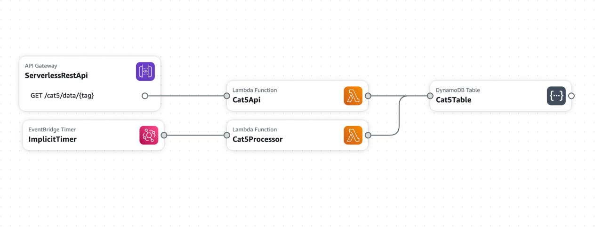

# CAT5
ESPN Fantasy Basketball H2H Categories Matchup Forecaster

Predict who will win each category

Predict who will win the matchup by winning Category Number 5!

https://cat5.jarno.site/


## Service
Deployed to AWS using Lambda, DynamoDB, API Gateway, and EventBridge using SAM.
Both Lambdas are zip packages. The processor zip is built in a Linux ARM64
container so NumPy and SciPy work in Lambda; deployment does not use ECR.

Cloud Infra:



### Local Development
Created with python

#### Set up virtual environment:
```sh
python -m venv .venv
source .venv/bin/activate
pip install -r requirements.txt
```

See [Makefile](Makefile) for dev commands

#### Test:
```sh
make check
make test-unit
make test-integration
make test-cloud-integration
```

#### Build and Deploy:
Requires Docker for the local build, plus AWS CLI and SAM CLI. Deployment
targets `cat5-stack` in `us-east-2` using [samconfig.toml](samconfig.toml).
```sh
make sam
make invoke-processor
make invoke-api
make deploy
```

### Private ESPN league

The processor reads ESPN session cookies from a Systems Manager Parameter
Store `SecureString`. Run `make set-espn-auth` from the repo root to create or
update the parameter. The script prompts without echoing the values, checks
the AWS account, and writes them in `us-east-2`. It stores:

- Name: `/cat5/espn-auth`
- Type: `SecureString` (the default `aws/ssm` key is sufficient)
- Value: `{"espn_s2":"YOUR_ESPN_S2","SWID":"{YOUR_SWID}"}`

To get the values, sign in to ESPN Fantasy in your browser, open developer
tools, and look under Application/Storage → Cookies for `espn_s2` and `SWID`.
Copy their values exactly, including the braces around `SWID`. Treat them as
account credentials. They never belong in Git, a Lambda event, or the browser
site. If ESPN invalidates the session, update this parameter with fresh values.

The `ScheduleDemon` EventBridge rule runs the processor daily at 12:00 UTC.
To refresh the cookies, run `make set-espn-auth` again; no redeploy is needed.
The [2027 event](processor/events/season.json) can also be invoked manually.
The UI checks the forecast's season before displaying it.


## UI
Created with React + Gatsby

See `package.json` for development commands
```sh
npm run start
npm run build
npm run serve
npm run deploy # to GitHub pages
```

Update [`gatsby-config.js`](/gatsby-config.js) for deployment configurations
